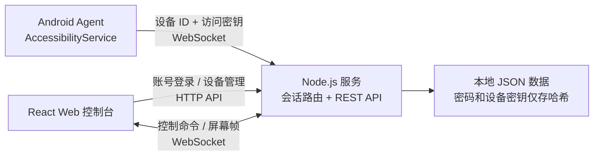

# Android Web 远程控制

一个面向**本人设备或设备所有者主动授权场景**的 Android 远程协助项目。Android Agent 通过无障碍服务采集屏幕、执行点击/滑动/系统导航和启动应用；用户在浏览器登录后，可以管理多台设备并建立实时控制会话。

项目不依赖 Root、ADB 常驻连接或 USB 数据线，适合个人设备管理、测试机协助和远程演示。请勿将它用于未经设备所有者明确授权的设备。

## 功能

- 账号登录和基于 JWT 的浏览器会话
- 管理员创建、修改、停用和删除账号
- 每个账号独立保存多台 Android 设备
- 新增、重命名和删除远程设备
- 设备 ID + 访问密钥双重校验
- 浏览器查看实时屏幕
- 点击、滑动、返回、主页和最近任务
- 获取并启动具有桌面入口的应用
- Android 端显示连接、认证、在线和重试倒计时状态
- 屏幕熄灭时尝试唤醒（能否越过锁屏受 Android 和厂商策略限制）
- 弱网络重连、重复连接隔离和屏幕帧背压控制

## 系统结构



数据流分为两部分：

1. Web 通过 REST API 登录和管理账号、设备。
2. Android 与 Web 分别连接同一个 WebSocket 服务，服务端按设备路由控制命令、设备信息和屏幕帧。

浏览器不能直接访问设备密钥。服务端只保存访问密钥的 bcrypt 哈希，设备在线后才会建立控制通道。

## 技术栈

| 模块 | 技术 | 作用 |
| --- | --- | --- |
| `apps/android` | Kotlin、Android AccessibilityService、OkHttp | 屏幕采集、手势执行、应用启动、WebSocket 设备端 |
| `apps/server` | Node.js、Express、ws、JWT、bcrypt | 登录鉴权、设备数据、账号管理、WebSocket 会话路由 |
| `apps/web` | React、TypeScript、Vite | 浏览器远程控制台 |
| `docs/protocol.md` | Markdown | WebSocket 消息协议 |
| `scripts/build-android.ps1` | PowerShell、Gradle | Windows 下构建 APK |

## 环境要求

- Node.js 20 或更高版本
- npm 10 或更高版本
- Android 11（API 30）或更高版本的设备/模拟器
- 构建 Android 时需要 JDK 17、Android SDK 35 和 Gradle 8.9

仓库内的 `.tools/` 仅作为本机工具目录使用，不进入 Git。也可以直接使用 Android Studio 打开 `apps/android`。

## 本地启动

### 1. 安装依赖

```powershell
npm install
```

### 2. 设置首次启动管理员

首次启动且数据库中还没有用户时，服务端要求显式提供管理员账号和至少 12 位的强密码。以下变量只设置在当前 PowerShell 会话中：

```powershell
$env:ADMIN_USERNAME = "your-admin-name"
$env:ADMIN_PASSWORD = "replace-with-a-strong-unique-password"

$secretBytes = New-Object byte[] 32
[Security.Cryptography.RandomNumberGenerator]::Fill($secretBytes)
$env:JWT_SECRET = [Convert]::ToHexString($secretBytes)
```

可参考 [`.env.example`](./.env.example)，但服务端不会自动加载该文件。生产环境应通过进程管理器、容器或系统服务注入环境变量。

常用服务端变量：

| 变量 | 必需性 | 说明 |
| --- | --- | --- |
| `ADMIN_USERNAME` | 首次启动必需 | 初始化管理员账号，仅在数据库无用户时使用 |
| `ADMIN_PASSWORD` | 首次启动必需 | 初始化管理员密码，至少 12 位 |
| `JWT_SECRET` | 建议显式设置 | JWT 签名密钥；未设置时会在数据目录生成 `.jwt-secret` |
| `DATA_DIR` | 可选 | 数据目录，默认是服务端当前目录下的 `data` |
| `PORT` | 可选 | HTTP/WebSocket 端口，默认 `8787` |

### 3. 启动服务端和 Web

```powershell
npm run dev
```

浏览器打开：

```text
http://localhost:5173/xiaoming/
```

Vite 开发服务器会把 `/api` 转发到 `127.0.0.1:8787`；浏览器 WebSocket 在开发模式下直接连接 `ws://localhost:8787/ws`。

## Android 构建和安装

### 构建

```powershell
npm run build:android
```

默认构建地址是 Android Studio 模拟器访问宿主机使用的：

```text
ws://10.0.2.2:8787/ws
```

可通过环境变量为一次构建指定其他地址：

```powershell
$env:REMOTE_SERVER_URL = "wss://control.example.com/xiaoming/ws"
npm run build:android
Remove-Item Env:REMOTE_SERVER_URL
```

APK 会生成到 `output/android/remote-control-agent-<版本号>.apk`，同时生成包含版本、文件大小和 SHA-256 的 `latest.json`。版本号直接读取 Android 构建元数据。`output/` 和 `*.apk` 已被 Git 忽略，不会推送到仓库。

### 安装到已连接设备

```powershell
.\.tools\android-sdk\platform-tools\adb.exe install -r .\output\android\remote-control-agent-0.7.0.apk
```

也可以把 APK 发送到本人手机后覆盖安装。覆盖安装会保留应用已有的设备 ID、访问密钥和服务地址。

### 首次使用

1. 打开 Agent，确认 WebSocket 服务地址。
2. 点击“开启远程控制权限”。
3. 在系统无障碍设置中启用“远程控制输入服务”。
4. 在 Web 控制台登录并选择“添加远程设备”。
5. 输入 Agent 页面显示的设备 ID 和访问密钥。
6. 等待设备显示在线，然后点击“连接设备”。

真机连接本地电脑时，不能填写 `localhost` 或 `10.0.2.2`，应填写电脑在局域网中的地址，并确认防火墙允许访问端口。不同模拟器访问宿主机的网关地址可能不同，请以模拟器文档为准。

## 常用命令

```powershell
npm run dev             # 同时启动服务端和 Web 开发环境
npm run test            # 运行服务端和 Web 自动化测试
npm run build           # 构建服务端和 Web
npm run build:android   # 构建 Android Debug APK
```

可选的模拟设备需要单独设置测试访问密钥：

```powershell
$env:MOCK_ACCESS_KEY = "your-test-access-key"
npm run mock -w apps/server
```

## 生产部署要点

本仓库只保存源码和安全的示例配置，不包含线上域名、服务器地址、数据库、部署密钥、Web 构建产物或 APK。

典型部署步骤：

1. 运行 `npm ci`、`npm test` 和 `npm run build`。
2. 将 `apps/server/dist` 部署为常驻 Node.js 服务。
3. 通过环境变量注入 `DATA_DIR`、`JWT_SECRET` 和首次启动管理员信息。
4. 将 `apps/web/dist` 放到静态文件目录。
5. 反向代理 `/xiaoming/api/*` 到服务端 HTTP API。
6. 为 `/xiaoming/ws` 启用 WebSocket Upgrade 转发。
7. 使用 HTTPS/WSS，并限制管理接口和数据目录的访问权限。
8. 定期备份数据目录，并保护其中的用户、设备和 JWT 密钥文件。

如果修改部署子路径，需要同步调整 `apps/web/vite.config.ts` 中的 `base`、Web API 前缀以及 WebSocket 地址生成逻辑。

### 登录后下载 APK

将带版本号的 APK 和对应 `latest.json` 上传到服务端 `DATA_DIR/downloads/`，或通过 `APK_DIR` 指定独立目录。先上传并校验 APK 的 SHA-256，再替换 `latest.json`，避免暴露未上传完整的安装包。目录应位于 Web 静态文件根目录之外，无需新增 Nginx 静态下载规则。

登录后页面顶部显示“下载 Android APK”及版本号。版本信息和文件均通过现有 `/api` 代理访问，要求有效且未停用的登录账号。前端以请求头传递令牌，下载链接不会携带令牌。APK 内置的服务地址应在构建时通过 `REMOTE_SERVER_URL` 指向当前部署站点；已有安装仍保留用户保存的地址。

## 安全边界

- 只控制本人设备或得到设备所有者明确授权的设备。
- Android 会要求用户手动开启无障碍服务，普通应用无法静默获得该权限。
- 不提交真实账号、密码、设备访问密钥、JWT 密钥、服务器 IP、SSH 配置和运行数据。
- 不建议在公网使用明文 HTTP/WS；生产环境应使用 HTTPS/WSS。
- 当前访问密钥在设备页面可见，分享截图前应遮挡。
- 浏览器令牌保存在 `sessionStorage`，关闭会话后不会长期持久化。
- 银行、支付、密码管理器以及设置了 `FLAG_SECURE` 的页面可能无法截图。
- Android 锁屏、厂商省电策略和后台限制可能阻止唤醒、截图或持续连接。
- “唤醒屏幕”不等于绕过 PIN、图案、密码或生物识别锁屏，本项目不实现绕过系统认证。

## 常见问题

### 一直显示正在重新连接

新版 Agent 会显示“连接服务器 → 验证设备信息 → 已连接”以及重试倒计时。长时间无法连接时依次检查：

1. 手机是否能访问 WebSocket 地址对应的 HTTP 服务。
2. Web 中保存的设备 ID 和访问密钥是否与 Agent 一致。
3. 无障碍服务是否开启，应用是否被系统省电策略限制。
4. 反向代理是否正确转发 WebSocket Upgrade 请求。
5. 服务端进程是否在线，数据目录是否可写。

### 设备在线但没有实时画面

- 退出并重新开启 Agent 无障碍服务。
- 检查当前页面是否使用 `FLAG_SECURE`。
- 切回普通系统页面验证截图能力。
- 检查 WebSocket 消息大小限制和反向代理超时。
- 弱网络下 Agent 会主动丢弃堆积帧，避免连接因发送队列过大而崩溃。

### Agent 页面文字显示为空白

0.5.0 及更高版本固定使用兼容浅色主题并显式设置文字颜色。旧版本需要覆盖安装新版 APK。

## 数据说明

默认数据文件为 `apps/server/data/remote-control.json`（具体位置取决于启动目录和 `DATA_DIR`）。其中包含账号和设备元数据；密码和设备访问密钥保存为 bcrypt 哈希。JWT 密钥默认保存在同一数据目录的 `.jwt-secret`。

这些文件全部被 `.gitignore` 排除。迁移或备份时应将整个数据目录作为敏感数据处理。

服务端只在数据文件不存在或文件包含有效空数据库时执行首次初始化。已有数据文件读取失败、JSON 损坏或结构不符合要求时，会明确报错并停止启动，不会自动清空或覆盖。遇到此类错误，应先保留原文件，再检查文件权限或从可靠备份恢复完整数据目录；不要通过删除原文件来恢复启动。

停用账号会立即撤销其远程连接；删除账号或设备会同时清理关联会话。设备重新绑定后，原账号的旧连接无法继续访问。最后一个查看者断开连接时，手机停止截屏上传；再次连接会重新启动屏幕流。

## 当前限制

- 屏幕传输采用 Base64 JPEG 帧，不是 H.264/WebRTC，画质和延迟取决于设备性能与网络。
- JSON 文件存储适合小规模个人使用，不适合大量设备或多实例并发写入。
- 尚未包含操作审计、密钥轮换、一次性配对、双因素认证和细粒度权限。
- 某些厂商系统需要额外允许自启动、后台运行和忽略电池优化。
- 系统安全页面和锁屏认证界面受 Android 安全策略保护。

## 协议

WebSocket 消息格式和控制命令参见 [`docs/protocol.md`](./docs/protocol.md)。

## 许可与责任

在引入生产环境前，请根据实际用途补充许可证、隐私政策、用户授权流程和操作审计。使用者需自行确保使用方式符合所在地法律法规、平台规则以及设备所有者授权范围。
